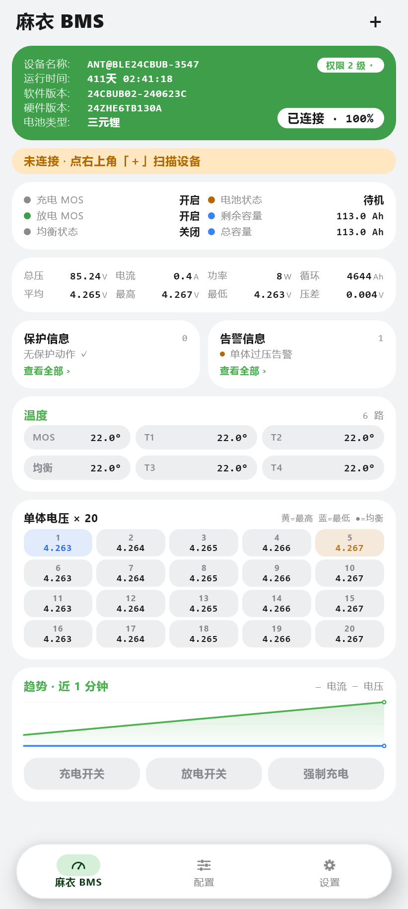
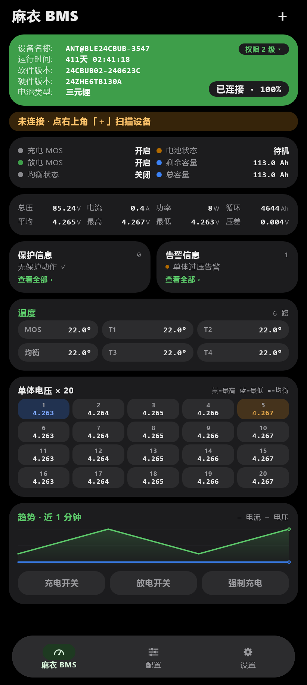
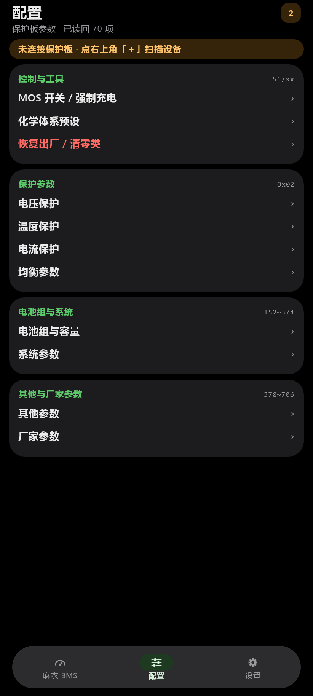
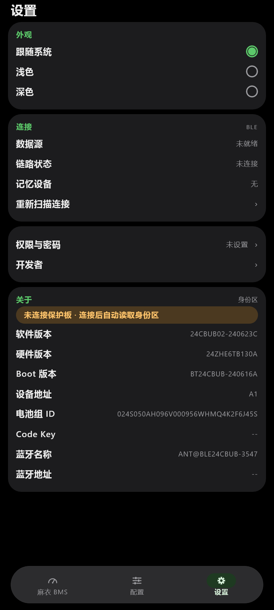

<p align="center"></p>

# 麻衣 BMS

> 蚂蚁 BMS（ANT BMS）保护板的非官方 Android 客户端 · 用 Kotlin Multiplatform + Compose Multiplatform 重写
>
> 官方客户端是个微信小程序：启动慢、没有深色模式、参数页要一层层点进去。这个项目把整套协议重新实现了一遍，做成一个原生应用。

**官网：** https://lswlc33.github.io/maibms/ —— 软件特性、界面预览与下载入口，不想翻 Releases 就直接看这里。

## 下载

| 渠道 | 适合谁 | 入口 |
| :--- | :--- | :--- |
| **正式版**（推荐） | 日常使用，稳定优先 | **[⬇ 最新正式版 Releases ›](../../releases/latest)** |
| **测试版** | 抢先体验新功能，可能不稳定 | **[⬇ 最新测试版（Pre-release）›](../../releases)** |
| **网页版** | 不想装东西、临时看一眼 | **[🌐 在浏览器里直接打开 ›](https://lswlc33.github.io/maibms/web/)** |

> **网页版**用安卓 Chrome（桌面 Chrome / Edge 也行）打开即可，不下载、不安装，靠 Web Bluetooth
> 直连保护板看实时数据与参数。受浏览器限制：关掉页面就断开、没有后台监控与通知、每次打开要重新选一次设备。
> 明细见 [网页版](#网页版)。
>
> 两个渠道每次发布都同时提供 **APK**（`maibms-<版本>.apk`，已签名）和 **未签名 ipa**
> （`maibms-<版本>-unsigned.ipa`，需自签安装，见 [iOS 构建](#ios-构建)）。
> 已签名 APK 两渠道同一密钥、可互相覆盖升级；应用内「设置 → 关于本软件」还能按渠道自动检查更新（默认稳定版）。
> 注：测试版 tag 形如 `v0.1.2-beta.32`，Releases 列表按语义化版本排序（新版在前）；正式版与测试版混排时以 tag 里的 `-beta.` 区分。
> 仓库里的 `docs/index.html` 是官网首页（GitHub Pages 入口），只展示软件特性与下载入口，不含协议文档内容。

<p>




</p>

---

## 软件特色

### 一、支持深色模式

深色模式不是简单反色：**深色下底色恒为纯黑 `#000000`**，卡片用比背景亮一档的深灰分层，OLED 屏幕更省电、对比也更干净；浅色下是极浅灰底 + 纯白卡片。三种模式可选（跟随系统 / 浅色 / 深色）并会记住选择，重启不丢。

### 二、界面信息更清晰

一屏之内把该看的都看完，而不是到处翻页：

- 仪表盘把设备信息、MOS/均衡状态、容量、总压电流功率、单体电压、温度、趋势曲线、控制开关全部铺在首屏，不需要来回切标签。
- 关键状态用颜色区分语义：单体电压网格里**最高格标黄、最低格标蓝**，均衡中的格带绿点；保护与告警分开两栏，各自带计数。
- 未连接时所有数值统一显示 `--` 而不是 `0`，不会把"没有数据"误读成"读数是零"。
- 链路状态分四态提示（未连接 / 连接中 / 掉线重连中 / 设备失联），失联时明确告诉你是信号问题而不是数据为零。

### 三、软件界面更优雅

- **无边框扁平卡片**：不靠描边分隔，只用底色明度差和 20dp 大圆角分块，视觉更安静。
- **悬浮式底栏**：左右留边、圆角浮起，选中项用 M3 药丸指示器。
- **页面过渡动画**：进入二级页从右滑入、返回原路退回、标签之间横向淡入淡出，底栏随页面进出场。
- **密度经过实测调优**：全局行高按字号等比收紧，列表行 30dp、开关为自绘紧凑控件，同一屏能多看三成内容；窄屏（360dp）单独复核过排版。

### 四、更快更稳

- **直连 BLE，不经过小程序容器**：冷启动即自动重连上次的设备。
- **自动升权**：密码按设备保存，连上后自动完成权限校验；**设备闲置导致权限回落时会静默重升**，不用手动再输一次密码。
- **掉线自愈**：常驻重连循环（失败退避 + 周期性切换 `autoConnect`），重新连上后自动重新升权、重新读取参数区。
- **应答匹配按「功能码 + 寄存器」双比对**，避免把上一条超时命令的迟到应答当成结果。
- 参数区一次读回 200+ 项，写参数走 `0x22` 并对 u32 容量类自动拆两帧写入，避免容量被截断。
- **写入结果有实锤**：优先取 `0x42` 同帧的 `0xFF` 结果段，没收到就回读该参数比对后再下结论，不会「写完什么都不显示」。

---

## 功能一览

| 页面 | 内容 |
| --- | --- |
| 仪表盘 | 电池大卡（整卡背景即电量进度）、MOS/均衡状态与容量（**MOS 关闭时显示断开原因**）、总压/电流/功率/循环、平均/最高/最低/压差、保护与告警、温度、20 串单体电压网格、趋势曲线与充电/放电/强制充电控制 |
| 配置 | 参数分组浏览与逐项编辑（写入前校验范围与倍率；**1~2 级只读、3 级及以上可写**，顶栏有「可编辑/只读/权限不足」指示）、控制命令（开关、化学体系预设、归零、重启、蜂鸣器、清零、蓝牙、恢复出厂等，高危项需输入「确认」） |
| 权限与密码 | 按设备保存各等级密码（一~四级 8 字节槽、五级/管理员 12 字节槽，管理员为点分十进制）、连接后自动升级目标可选、密码可随时修改/清除、保存时直接向设备校验 |
| 设置 | 外观主题、连接状态与重扫、**通信通道**（默认 / 备用 A / 备用 B：当前通道、手动切换、按设备记住选择）、**后台与通知**（后台监控 / 告警通知，见下）、设备身份区信息（版本 / 电池类型 / 电池组 ID / 蓝牙地址） |
| **设备日志** | **读设备内保存的历史事件（`0x13`）与保护动作次数（`0x15`）**：逐条事件（时间 / 事件名 / 当时的总压·电流·SOC 等数据项）＋ 20 项累计计数（循环次数高亮）。回答「为什么跳保护、什么时候跳的」 |
| 开发者 | **分级日志**：帧级/操作级/警告/错误四级，可过滤、按级别着色、复制、**导出为文件**、清空；**轮询频率三档**（900 / 600 默认 / 300ms）；**链路统计**（最近 60 拍的往返耗时、应答成功率、丢弃的通知帧数——判断"该不该降档/换通道"的客观依据） |

### 后台与通知

退到后台之后干什么，此前没有策略：仍按当前档位轮询、占着 BLE 连接，却既没有展示也没有通知。现在分两档（设置 → 后台与通知）：

| 后台监控 | 退到后台的行为 | 提醒 |
| --- | --- | --- |
| **关**（默认） | **暂停轮询**省电；连接保留，回前台立刻恢复（不重连） | 无 |
| 开 | 前台服务保活 + 持续轮询，常驻一条低优先级通知（设备名 · 电量 · 总压） | **保护/告警新触发**、**设备失联**各发一条通知（只报上升沿，同一位 5 分钟合并；MOS 开/待机这类常态状态位不通知；前台不重复提醒） |

通知只在 Android 提供（前台服务 + 通知渠道）；iOS 与桌面端不做后台保活，也不发系统通知，轮询节奏不受前后台影响。

### 日志系统

排查问题不必每次都接 adb——协议层的关键信息都记在应用内（**设置 → 开发者**）：

| 级别 | 内容 | 默认 |
| --- | --- | --- |
| **D** 帧级 | 收发帧原文、扫描发现、MTU 协商、轮询超时 | 关闭（按需开启） |
| **I** 操作级 | 连接/断开/选设备、自动升权、参数区读回、写参数、控制命令、密码校验、界面操作 | 开 |
| **W** 可恢复 | GATT 掉线、重试退避、失联判定、校验无应答 | 开 |
| **E** 失败 | 扫描失败、写参数被拒（含设备返回的限值）、命令被拒、解码失败 | 开 |

- 环形缓冲 600 条，约两次完整连接会话；可一键清空。
- **导出日志**：Android 10+ 写入 `Download/maibms/` 并弹分享面板（MediaStore，无需存储权限）；
  Android 8/9 没有存储权限，自动退到应用私有外部目录（路径会在界面上显示，USB/文件管理器可取）；
  桌面写入 `~/maibms-logs/`；iOS 写入 Documents（需在「文件」App 里取）。导出文本带可读时间戳与级别。
- 同时镜像到 logcat / stdout，`adb logcat -s System.out | grep ANTBMS` 照旧可用。
  **帧的十六进制只在「帧级日志」开关打开时才拼**（关着时输出 `← 245B` 这样的长度行）——
  一帧 245 字节的十六进制是 245 次字符串分配、还发生在蓝牙回调线程上，每拍都拼会推迟收帧；
  要用 adb 看报文，先把开关打开（开关会落盘记住）。


---

## 安装

从上面的[下载](#下载)入口取对应的 `maibms-<版本>.apk` 直接安装即可（已签名，同一密钥可覆盖升级）。

- 最低支持 Android 8.0（API 26）。
- 首次启动会申请「附近的设备」权限，用于扫描并连接保护板。
- 应用只与保护板通信；唯一的联网行为是「检查更新」——只读 GitHub Releases 的公开接口
  （连不上时自动走国内镜像回退），不采集、不上传任何数据。

---

## 从源码构建

环境要求：**JDK 17**、**Android SDK**（`platforms;android-35`、`build-tools;35.0.0`）。

```bash
# 设置 Android SDK 路径（Windows 例）
export ANDROID_HOME="$LOCALAPPDATA/Android/Sdk"

# 单元测试（协议解析 / 数据管线）
./gradlew :composeApp:desktopTest

# 调试包
./gradlew :composeApp:assembleDebug

# 发布包（需要下面的签名配置）
./gradlew :composeApp:assembleRelease

# 桌面端跑起来看 UI
./gradlew :composeApp:run

# 离屏渲染 UI 截图到 composeApp/build/shots/（无需设备）
./gradlew :composeApp:shot

# 网页版：打包并同步到 docs/（Node 18+，首次会自动装 webpack 工具链）
./gradlew :webApp:syncWebToDocs
```

### iOS 构建
KMP 让界面、协议解析、数据这些**共享代码**一次编写三端复用；但**蓝牙**与 **App 外壳**
天生要按平台各写一份，iOS 侧这两块现在也补齐了（`iosMain/transport/IosBleTransport.kt`
与 `iosApp/` 壳工程）。iOS 侧在 CI 里分成两条线：**出包**（预发布与正式版两条流水线各自打一个
未签名 ipa，见[发布流程](#发布流程)）和**验证**（按需触发的 `ios-test.yml`）。

要完整验证一遍 iOS 侧，手动跑 `Actions → IPA 测试 → Run workflow`，它按顺序做：

```bash
# 1) 单元测试（协议解析 / 数据管线）
./gradlew :composeApp:desktopTest

# 2) 公共代码的平台中立性：commonMain 若混入 JVM 专属 API（java.* / System.* / String.format）会立刻失败
./gradlew :composeApp:compileCommonMainKotlinMetadata

# 3) 编译 + 链接两档 framework（arm64 真机 / arm64 模拟器；静态 framework 无需签名）
./gradlew :composeApp:linkDebugFrameworkIosArm64 :composeApp:linkDebugFrameworkIosSimulatorArm64

# 4) 用与发布**完全相同**的动作打一个未签名 ipa（Release 配置，包体最小）
#    .github/actions/build-unsigned-ipa/ —— xcodegen → xcodebuild → Mach-O 数量与体积核检 → 封 ipa
# 5) 模拟器安装 + 启动冒烟（3s / 5s / 15s 各截一张图），并收集运行日志与崩溃报告
```

产物：`ios-test-ipa`（未签名 ipa，可自签安装）与 `ios-test-artifacts`（截图 + 运行日志 +
`.ips` 崩溃报告，**无论测试成败都会上传**——启动崩溃的现场就靠它）。日常 `main` 推送不跑它，
那会拖慢出包速度；「iOS 还能不能编过」由出包流水线兜着。

**自己装到 iPhone 上？** 从 Actions 运行的制品区下载 `ios-unsigned-ipa`，用
Sideloadly / 爱思助手 / AltStore 这类工具，以你的 Apple ID 自签后安装：

- ipa 里只有主执行文件一个 Mach-O（`iosApp/project.yml` 显式关掉了 Xcode 16 Debug 默认的
  `iosApp.debug.dylib`）：自签工具只需签这一个二进制，装完即可启动；
- 免费 Apple ID 签名 **7 天过期**，到期需重签（工具里再点一次即可）；
- 付费开发者账号（¥688/年）可签一年；
- 首次启动需在「设置 → 通用 → VPN与设备管理」里信任该开发者证书。

> Apple 目标**只能在 macOS 上编译**（Windows/Linux 连编译都做不了，首次还需下载约 1GB 的
> Kotlin/Native 工具链）。CI 已缓存 Gradle 与 `~/.konan`，重复运行快得多。
> 本地 Mac 上构建：装 **Xcode 16+**（xcodegen 生成的工程是 Xcode 16 的格式）与
> `brew install xcodegen`，然后 `cd iosApp && xcodegen generate`，打开生成的工程即可运行。

入口是 `MainViewControllerKt.MainViewController()`（`iosMain/MainViewController.kt`），
由壳工程的 `ComposeView` 挂成根视图控制器。iOS 侧平台实现一览：

| 能力 | iOS 实现 | 说明 |
| --- | --- | --- |
| **蓝牙** | **CoreBluetooth（IosBleTransport）** | 与 Android 同一套契约：FFE0 服务、通道候选 FFE1/FFF3-4/FFF5-6、订阅落地才算就绪、12ms 分片写入、常驻重连退避。差异：iOS 不暴露 MAC（用系统外设标识当"地址"）、无 MTU 协商 API（用单次写上限）、连接前必须先扫描到设备 |
| 日期时间 | kotlinx-datetime（公共代码） | 与 Android/桌面输出逐字符一致 |
| 日志落盘 | okio（Application Support/maibms-logs） | 保留 3 天、按天一个文件 |
| 检查更新 | NSURLSession | 同样的镜像回退链与超时策略 |
| 剪贴板 | UIPasteboard | 开发者页「复制日志」 |
| 日志导出 | 写入沙盒 Documents | 「文件」App 可取走 |
| 锁 | NSRecursiveLock | 替代 JVM 的 synchronized |
| 设置存储 | NSUserDefaults（UserDefaultsStore） | 对应 Android 的 SharedPreferences；设备/密码/主题等偏好重启保留 |
| BLE 传输 | **无**（NoopTransport） | 需要 CoreBluetooth 实现，属后续工作 |
| **系统栏 / 沉浸** | SwiftUI 壳工程（`ContentView.swift`）+ `IosSystemChrome` 单例 | 窗口整屏铺满（`.ignoresSafeArea(.container)`），安全区避让全交给 Compose 的 `WindowInsets`；横屏表盘隐藏状态栏与 Home 指示条；状态栏文字配色跟随**应用**外观而不是系统 |
| **后台监控 / 通知** | **无**（通知出口未注入 = 空实现） | iOS 与桌面端不做后台保活、不发系统通知（`AppForeground` 恒为「前台」，所以"退后台暂停轮询"也只对 Android 生效）。公共代码里只留一个可注入的 `Notifier` 接口，将来接入 `UNUserNotificationCenter` 时不必动数据层 |

> **沉浸是怎么落地的**：iOS 的状态栏「隐不隐、文字是黑是白」只有窗口根控制器
> （SwiftUI 的 hosting controller）说了算，Kotlin 侧改不动它；而「是否沉浸 / 应用外观」
> 又只有 Compose 知道（横屏表盘、外观设置）。所以 Compose 把这两项写进 `IosSystemChrome`
> 单例（`iosMain/ui/SystemChrome.ios.kt`），壳工程注册回调后用 `.statusBarHidden` /
> `.persistentSystemOverlays`（iOS 16+，隐藏 Home 指示条）/ `.preferredColorScheme` 落地。
> 外观为**「跟随系统」时不能覆盖**颜色方案——覆盖会把 trait collection 钉死，
> `isSystemInDarkTheme()` 读回来的就是被覆盖后的值，用户之后切回「跟随系统」会永远跟不上。

### 应用图标

启动器图标与桌面端窗口图标都由 `tools/icon/generate_icons.py` 从 `tools/icon/source.jpg` 生成（需要 Pillow）：

```bash
python tools/icon/generate_icons.py             # 重新生成 androidMain/res/mipmap-* 与桌面端图标
python tools/icon/generate_icons.py --preview   # 只画预览图（.shots/icons/），看各蒙版裁切效果
python tools/icon/generate_icons.py --variants  # 并排对比几组候选构图，用来换取景
```

图标不是把原画等比缩小：Android 从 API 26 起由启动器按自己的形状（圆形 / 圆角方形）裁一刀，只保证中间 66dp 的圆形安全区完整可见，所以画面是**按安全区重新取的景**——参数在脚本顶部的 `CROP` / `INSET_DP` / `ZOOM`。

### 签名配置

为了让**手动构建**和 **CI 构建**产出的 APK 签名一致（否则无法互相覆盖安装），两边使用同一个密钥：

本地：在仓库根放 `keystore.properties`（已在 `.gitignore` 中，不会入库）

```properties
storeFile=maibms-release.jks
storePassword=……
keyAlias=maibms
keyPassword=……
```

CI：仓库 Secrets 里配置 `SIGNING_KEYSTORE_BASE64`（keystore 文件的 base64）、`SIGNING_STORE_PASSWORD`、`SIGNING_KEY_ALIAS`、`SIGNING_KEY_PASSWORD`，工作流会把它解成文件后导出 `SIGNING_KEYSTORE_FILE` 再交给 Gradle。

> 没有配置签名材料时，构建会退回 debug 签名，仅供本地跑通，不要用于发布。

---

## 发布流程

三个工作流（`.github/workflows/`），外加一个被两条出包流水线共用的动作
`.github/actions/build-unsigned-ipa/`（打未签名 ipa：xcodegen → Release 配置构建 →
Mach-O 数量与体积核检 → 封 ipa；同样的逻辑写两份迟早会漂移，所以抽成一个）：

| 工作流 | 触发 | 做什么 |
| :--- | :--- | :--- |
| **Beta · 预发布**（`beta.yml`） | 推送到 `main` 自动 | 版本名加 `-beta.<序号>`，**APK 与 ipa 并行构建**，两个产物一起挂到同一个 pre-release，并清理较旧的 beta |
| **Release · 正式版**（`release.yml`） | 手动 | 递增 `versionCode` / `versionName`，**两个包都成功后才提交版本号**、打 tag、发布正式 Release；APK 与 ipa 一起上传 |
| **IPA 测试**（`ios-test.yml`） | 手动 | iOS 全流程验证：单元测试、平台中立性、framework 编链、ipa 打包、模拟器启动冒烟 + 截图 + 日志（见 [iOS 构建](#ios-构建)） |

出包流水线的两条硬性目标：

- **快**：APK（ubuntu）与 ipa（macOS）是两个并行 job，总时长取较长的那一个；模拟器冒烟这种重活
  只在 IPA 测试里跑，不拖累每次出包。
- **小**：ipa 用 Release 配置构建（默认的 Debug 带调试符号与 `-Onone`，实测 18.4MB → 14.3MB）；
  APK 侧 R8 混淆 + 资源收缩在 `composeApp/build.gradle.kts` 里。

正式版「先构建、都成功才提交」：失败时不会往 `main` 留一个「已自增未发布」的版本号提交；如果构建
期间有人又推了版本号，发布步骤会直接中止，避免把基于旧版本构建出来的包当成最新版发出去。提交版本
号时会顺手把 `docs/index.html` 里的内联版本兜底（接口拉不到时官网显示的就是它）同步到本次发布。

### 发布前检查（正式版）

- `./gradlew --offline :composeApp:desktopTest :composeApp:lintDebug` 全绿（lint 目前是独立检查，
  不在 Release 工作流里，别漏跑）；
- Actions 手动跑一次「IPA 测试」（framework 编链 + 模拟器启动冒烟 + 截图）；
- 把 Release APK 装到真机/MuMu，走一遍连接、仪表盘、配置读写、日志导出、后台通知；
- 确认 `composeApp/build.gradle.kts`、`iosApp/project.yml`、`docs/index.html` 三处版本号一致；
- 确认 4 个签名 secret 已配置，Release 工作流的 apksigner 校验通过。

---

## 协议文档

`docs/` 下是这套 BLE 协议的完整逆向笔记（21 篇 + 5 个附录），也是本项目实现的依据。从 [docs/README.md](docs/README.md) 进入，主要章节：

| 文档 | 内容 |
| --- | --- |
| [01-概述](docs/01-概述.md) | 协议分层、设计特点、能力总览 |
| [02-蓝牙链路](docs/02-蓝牙链路.md) | GATT 服务、连接与重连策略 |
| [03-帧格式与校验](docs/03-帧格式与校验.md) | 帧结构、CRC 校验 |
| [04-功能码总表](docs/04-功能码总表.md) | 全部功能码与含义 |
| [05-实时数据](docs/05-实时数据.md) | 实时帧字节布局（含协议合法样例） |
| [06-参数读写](docs/06-参数读写.md) | 参数区分块读、单参数写、结果码 |
| [07-控制命令](docs/07-控制命令.md) | 控制命令与应答 |
| [09-权限与身份](docs/09-权限与身份.md) | 权限等级、密码槽、身份区 |
| [11-采集芯片与扩展帧](docs/11-采集芯片与扩展帧.md) | 采集芯片、扩展帧 |
| [15-实战与调试指南](docs/15-实战与调试指南.md) | 真机联调踩过的坑 |
| [附录A 参数寄存器表](docs/附录A-参数寄存器表.md) | 全部参数地址、倍率、单位 |
| [附录D 样例报文](docs/附录D-样例报文.md) | 可直接用于测试的真实报文 |

> 注意：`unpack/`（官方小程序解包结果）属于第三方资料，**不在仓库内**，`.gitignore` 已排除。

---

## 网页版

网页版把同一个 Kotlin 引擎（`protocol/` + `data/` + `transport/`）编到 **Kotlin/JS**，
配一层自写的 DOM 界面（`webApp/`），用 **Web Bluetooth** 直连保护板。协议解析、参数表、
命令语义与 Android/iOS 版**是同一份代码**，所以不会出现"网页和 App 读数不一样"。

- **在线地址**：<https://lswlc33.github.io/maibms/web/>（默认主题；其它主题见页面内「切换主题」）
- **支持的浏览器**：安卓 Chrome（免开任何 flag）、桌面 Chrome / Edge。
  Safari、Firefox、微信/QQ 内置浏览器都不支持 Web Bluetooth。
  **iPhone / iPad 会整页拦截**：iOS 的 Safari 与所有 iOS 浏览器（套壳也走 WebKit）
  都没有 Web Bluetooth，进页面直接显示提示，引导换 Android Chrome 或装 App。
- **必须 https 或 localhost**：浏览器的安全上下文要求，不是本项目的选择。

### 浏览器带来的限制（不是 bug）

| 限制 | 原因 |
| :--- | :--- |
| iPhone / iPad 整页屏蔽 | iOS 的 Safari 和所有 iOS 浏览器都不提供 Web Bluetooth（App Store 要求套壳也走 WebKit）；由 `maibms-host.js` 在数据层之前识别并铺全页提示 |
| 关掉页面就断开 | 浏览器不允许网页在后台常驻蓝牙连接 |
| 没有告警通知、没有后台监控 | 没有后台执行环境，通知也无从发起 |
| 每次打开要重新选一次设备 | `requestDevice()` 必须在用户手势里调用，且授权只在该页面会话内有效 |
| 设置里没有「检查更新」 | 网页每次打开加载的都是最新构建，不存在"已安装的旧版本" |
| 日志不落盘 | 浏览器不能写用户磁盘；改为「复制到剪贴板」 |
| 配置只存在本机浏览器 | 密码/历史设备/快照存 `localStorage`，清缓存或换浏览器会丢 |

想要后台监控、告警通知、常驻重连这些能力，请用 Android 版。

### 本地构建与预览

网页版是**一个数据层 + 多套主题页**的结构，全部在 `docs/web/` 下：

```
docs/maibms-data.js     ← Kotlin/JS 产物：BLE + 协议 + 状态桥（唯一需要构建的文件）
docs/web/index.html     ← 默认主题（移动卡片流 + 底部标签）
docs/web/mdui.html      ← Material 主题（mdui 2 组件库，底部导航）
docs/web/daisy.html     ← Daisy 主题（Tailwind + daisyUI，卡片网格）
docs/web/admin.html     ← 控制台主题（Bootstrap 侧栏仪表盘，宽屏多列 bento）
docs/web/console.html   ← 终端主题（等宽 HUD + 字符进度条 + 键盘快捷键）
docs/web/paper.html     ← 杂志主题（排版优先，特大数字，无卡片）
docs/web/switch.html    ← 主题切换页
docs/web/maibms-host.js ← Kotlin 与 JS 之间 5 个动态属性函数 + iOS 设备拦截（见下方「为什么需要它」）
```

**六套主题 = 三种导航布局（底部标签 / 底部导航 / 侧栏 / 顶部文字链接）× 多种视觉语言**，
全部吃同一份 `window.Maibms` 数据，加一套新主题不用重编 Kotlin。
终端主题还支持键盘快捷键（1~4 切面板、C 连接、X 断开）。

```bash
# 构建数据层并同步到 docs/（只同步 maibms-data.js；主题页是手写文件，不经过构建）
./gradlew :webApp:syncWebToDocs

# 本地看效果（Web Bluetooth 在 localhost 上可用）
cd docs && python -m http.server 8099
# 浏览器打开 http://127.0.0.1:8099/web/
```

没有保护板也想看界面？地址后面加 `?preview=1`（如 `http://127.0.0.1:8099/web/?preview=1`），
会载入一份内置示例数据，把总览/单体/温度/趋势/参数全画出来。它不写任何持久化状态，刷新即回真实态。

### 实现要点

Kotlin 侧**只做数据层**，通过 `window.Maibms` 暴露三类东西（`webApp/src/jsMain/.../Bridge.kt`）：

| 成员 | 用途 |
| :--- | :--- |
| `Maibms.state` / `onState(fn)` | 一份 JSON 快照 + 订阅（每次数据变化推整份） |
| `Maibms.meta()` | 参数分组、命令表、设备族（不常变，含**已格式化的参数显示值**）；设备列表与设置随 `state` 每拍推 |
| `Maibms.connect()` / `auth()` / `writeParam()` / `control()` … | 动作，返回 Promise（鉴权、写参数、控制命令的结果对象） |

刻意**不做细粒度 diff**：轮询 600~900ms 一次，整份重画对浏览器毫无压力；
而细粒度更新会在每套主题里引入"某处忘了刷新"的 bug——这是主题系统最容易翻车的地方。

六套主题的取舍（后三套是本轮新增的**布局风格**实验）：

- **默认**：无边框扁平卡片，手写 CSS。视觉与 Android/iOS 版对齐，无外部依赖，离线可用。
- **Material**：mdui 2 组件库（Web Component）。验证"换成组件库不影响功能"。
  图标用**内联 SVG**（`ICON_PATHS` 表）而非 Material Icons 字体——那个字体只能从
  `fonts.googleapis.com`（国内不可达）或镜像（Pages 实测也挂）拿，赌 CDN 不如零依赖。
  若回退字体方案：变体后缀是**双横线**（`name--rounded`），Filled 不带后缀。
- **Daisy**：Tailwind CSS + daisyUI 4。验证"换成原子化 CSS 框架也不影响功能"。
  注意 Tailwind 自带 `.ring` 工具类，自定义类名要避开（这里把 SOC 环改成了 `.soc-ring`）。
- **控制台（admin）**：Bootstrap 5 侧栏仪表盘，宽屏 12 列 bento。注意 Bootstrap 5.1+
  自带 `.grid`/`.col-*` 组件类，自定义网格要换前缀（这里用 `.mw-grid`），
  且列模板要 `minmax(0, 1fr)` 防内容撑爆。
- **终端（console）**：等宽字体 HUD，字符进度条 + 键盘快捷键，深色常驻。
- **杂志（paper）**：Pico classless，排版优先——特大 SOC 数字、图注式指标、细线键值行，无卡片。

#### 为什么需要 `maibms-host.js`

Kotlin/JS 里"往 JS 对象上挂动态键"三条路都有坑（都实测过）：

- `api.foo = x`（`dynamic` 静态名赋值）会被编译成属性/设置器访问，**静默丢弃**——
  `window.Maibms` 存在但 `Object.getOwnPropertyNames()` 是空数组，且不报错；
- `js("(function(o,k,v){o[k]=v})")` 会被当**表达式求值**（编译期就调掉了），
  `o[k]=v` 根本不会出现在产物里；
- `@JsFun` 在 Kotlin 2.1 的 stdlib 里是 `internal`，业务代码引不到。

所以这 5 个函数写成真正的手写 JS（`maibms-host.js` 的 `MaibmsHost`），Kotlin 只做 external 声明。
**页面加载顺序必须是**：`maibms-host.js` → `maibms-data.js` → `theme-xxx.js`。

另外两个踩过的坑（写在新主题里时要避开）：

- `external object JSON` 的名字**必须与全局一致**。曾写成 `external object JsJson`，
  运行时抛 `ReferenceError: JsJson is not defined`，又被外层 `runCatching` 吞掉，
  表现成"数据层加载了但 `window.Maibms` 不存在"——极难查。
- webpack 默认把产物打成 **UMD library**，那种形态下 `main()` **不会自动执行**。
  已在 `webApp/build.gradle.kts` 里清掉 `output.library`，让 `main()` 随脚本加载即运行。

---

## 目录结构

```
composeApp/src/
├── commonMain/          # 跨端共享：协议解析、数据层、全部 UI
│   └── kotlin/io/github/lswlc33/maibms/
│       ├── protocol/    # 帧解析、实时数据解码、参数字典、位域字典
│       ├── data/        # 仓库层（连接/轮询/命令队列）、状态流、落盘
│       ├── transport/   # 传输抽象（Android BLE / iOS CoreBluetooth / Noop）
│       └── ui/          # Compose 界面
├── androidMain/         # Android BLE 实现、Activity、系统返回键、剪贴板、启动器图标资源、后台监控服务与通知
├── iosMain/             # iOS CoreBluetooth 传输与各平台实现
├── desktopMain/         # 桌面入口 + 离屏截图工具（QA 用，不进 APK）
└── desktopTest/         # 协议与数据管线单元测试
webApp/src/jsMain/       # 网页版：复用上面 protocol/data/transport 源码 + DOM 界面
iosApp/                  # iOS 壳工程（Xcode 工程文件，见 iOS 构建）
```

图标原画与生成脚本在 `tools/icon/`（见[应用图标](#应用图标)）。

---

## 免责声明

本项目是非官方开源客户端，与保护板厂商无任何关联，协议实现来自对设备通信的观察与逆向分析。修改保护板参数可能影响电池安全，**请自行确认参数含义后再写入**，因使用本软件造成的任何后果由使用者承担。

## 许可证

[MIT](LICENSE)
